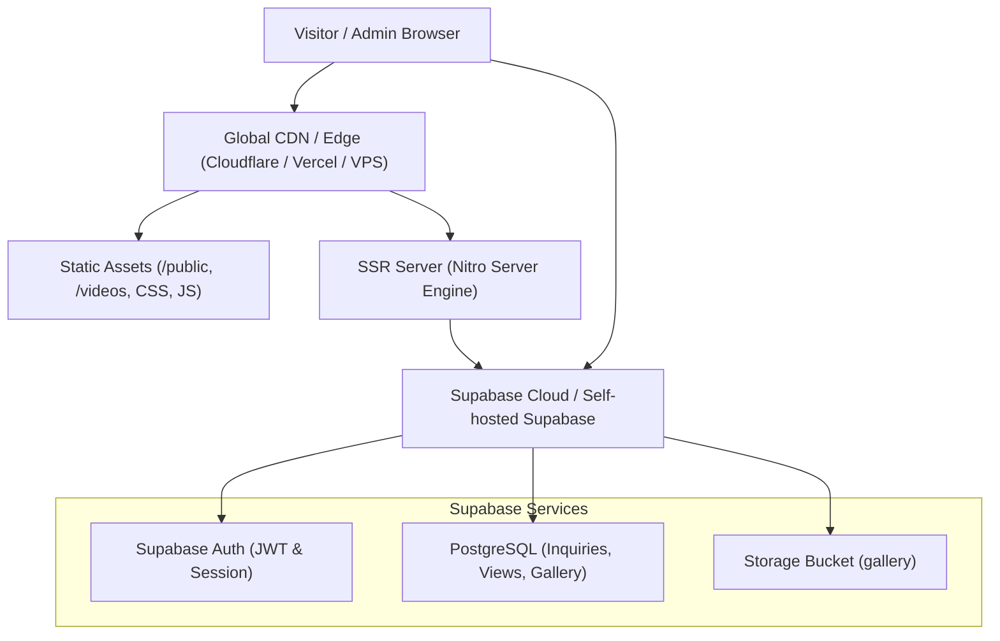

# Complete Self-Hosting Guide for SR Studio

## How to Host Without Lovable Publish

This project is built on open standards and modern web technologies:

- **Framework:** [TanStack Start](https://tanstack.com/start) (React 19 + TanStack Router)
- **Bundler & Server Engine:** [Vite](https://vite.dev) & [Nitro](https://nitro.unjs.io/)
- **Database, Auth & Storage:** [Supabase](https://supabase.com)
- **Styling:** [Tailwind CSS v4](https://tailwindcss.com)

You do **not** need Lovable to build, deploy, or run this application. You can host it completely independently on:

1. **Cloudflare Workers / Pages** (Fastest & Native Default)
2. **Vercel**
3. **Netlify**
4. **Self-Hosted VPS / Docker / Coolify / Railway / Render**

---

## Architecture Overview



---

## Step 1: Set Up Your Supabase Backend

The backend database, admin authentication, inquiry forms, and image uploads rely on Supabase.

### 1.1 Create a Free Supabase Project

1. Go to [supabase.com](https://supabase.com) and create an account.
2. Click **New Project**, choose a project name (e.g., `sr-studio`), set a database password, and select a region close to your target audience (e.g., `South Asia (Mumbai)`).

### 1.2 Run the SQL Schema & Security Rules

1. In the Supabase Dashboard, open **SQL Editor** from the left navigation.
2. Click **New query**.
3. Copy and paste the entire contents of `drizzle/migrations/0000_admin_gallery_analytics.sql`:

```sql
create type public.app_role as enum ('admin', 'user');
create table public.user_roles (
  id uuid primary key default gen_random_uuid(),
  user_id uuid references auth.users(id) on delete cascade not null,
  role app_role not null,
  unique (user_id, role)
);
grant select on public.user_roles to authenticated;
grant all on public.user_roles to service_role;
alter table public.user_roles enable row level security;
create policy "Users read own roles" on public.user_roles for select to authenticated using (auth.uid() = user_id);

create or replace function public.has_role(_user_id uuid, _role app_role)
returns boolean language sql stable security definer set search_path = public as $$
  select exists (select 1 from public.user_roles where user_id = _user_id and role = _role)
$$;

-- First account ever created automatically becomes the admin
create or replace function public.assign_first_admin()
returns trigger language plpgsql security definer set search_path = public as $$
begin
  if not exists (select 1 from public.user_roles where role = 'admin') then
    insert into public.user_roles (user_id, role) values (new.id, 'admin');
  end if;
  return new;
end; $$;
create trigger on_auth_user_created_admin after insert on auth.users
for each row execute function public.assign_first_admin();

create table public.gallery_images (
  id uuid primary key default gen_random_uuid(),
  title text not null,
  category text not null,
  image_url text not null,
  storage_path text,
  tall boolean not null default false,
  created_at timestamptz not null default now()
);
grant select on public.gallery_images to anon, authenticated;
grant insert, update, delete on public.gallery_images to authenticated;
grant all on public.gallery_images to service_role;
alter table public.gallery_images enable row level security;
create policy "Anyone views gallery" on public.gallery_images for select to anon, authenticated using (true);
create policy "Admins insert gallery" on public.gallery_images for insert to authenticated with check (public.has_role(auth.uid(), 'admin'));
create policy "Admins update gallery" on public.gallery_images for update to authenticated using (public.has_role(auth.uid(), 'admin'));
create policy "Admins delete gallery" on public.gallery_images for delete to authenticated using (public.has_role(auth.uid(), 'admin'));

create table public.page_views (
  id uuid primary key default gen_random_uuid(),
  path text not null,
  referrer text,
  language text,
  created_at timestamptz not null default now()
);
grant insert on public.page_views to anon, authenticated;
grant select on public.page_views to authenticated;
grant all on public.page_views to service_role;
alter table public.page_views enable row level security;
create policy "Anyone logs a view" on public.page_views for insert to anon, authenticated
  with check (char_length(path) <= 200 and (referrer is null or char_length(referrer) <= 500) and (language is null or char_length(language) <= 20));
create policy "Admins read views" on public.page_views for select to authenticated using (public.has_role(auth.uid(), 'admin'));

create table public.inquiries (
  id uuid primary key default gen_random_uuid(),
  name text not null, email text not null, wedding_date date, location text,
  services text[] not null default '{}', message text,
  created_at timestamptz not null default now()
);
grant insert on public.inquiries to anon, authenticated;
grant select, delete on public.inquiries to authenticated;
grant all on public.inquiries to service_role;
alter table public.inquiries enable row level security;
create policy "Anyone sends inquiry" on public.inquiries for insert to anon, authenticated
  with check (char_length(name) <= 100 and char_length(email) <= 255 and (message is null or char_length(message) <= 1000));
create policy "Admins read inquiries" on public.inquiries for select to authenticated using (public.has_role(auth.uid(), 'admin'));
create policy "Admins delete inquiries" on public.inquiries for delete to authenticated using (public.has_role(auth.uid(), 'admin'));

create policy "Public read gallery files" on storage.objects for select using (bucket_id = 'gallery');
create policy "Admins upload gallery files" on storage.objects for insert to authenticated with check (bucket_id = 'gallery' and public.has_role(auth.uid(), 'admin'));
create policy "Admins delete gallery files" on storage.objects for delete to authenticated using (bucket_id = 'gallery' and public.has_role(auth.uid(), 'admin'));
```

4. Click **Run**. This provisions all tables, functions, triggers, and Row Level Security policies.

### 1.3 Create the Storage Bucket for Gallery Uploads

1. Go to **Storage** > **New Bucket**.
2. Bucket Name: `gallery` (exact name required).
3. Toggle **Public bucket** to `ON`.
4. Click **Save**.

### 1.4 Configure Auth Redirect URLs

1. In Supabase Dashboard, go to **Authentication** > **URL Configuration**.
2. Set **Site URL** to your production domain: `https://your-domain.com`.
3. Under **Redirect URLs**, add:
   - `https://your-domain.com/admin`
   - `https://your-domain.com/auth`
   - `http://localhost:5173/admin` (for local development)
   - `http://localhost:5173/auth`

### 1.5 Collect API Credentials

Go to **Project Settings** > **API**:

- **Project URL:** `https://xyzcompany.supabase.co`
- **anon / public key:** `sb_publishable_...` (or standard JWT `eyJ...`)
- **service_role key:** `sb_secret_...` (keep secret!)

---

## Step 2: Environment Variables

Create or update your production environment variables.

| Variable Name                   | Description                     | Where to use                    |
| ------------------------------- | ------------------------------- | ------------------------------- |
| `VITE_SUPABASE_URL`             | Your Supabase Project URL       | Client & Build                  |
| `VITE_SUPABASE_PUBLISHABLE_KEY` | Supabase Anon / Publishable Key | Client & Build                  |
| `SUPABASE_URL`                  | Supabase Project URL            | Server runtime                  |
| `SUPABASE_PUBLISHABLE_KEY`      | Supabase Anon / Publishable Key | Server runtime                  |
| `SUPABASE_SERVICE_ROLE_KEY`     | Supabase Service Role Key       | Server runtime (optional/admin) |

> [!TIP]
> Both `VITE_` and non-`VITE_` variables are provided so that client bundles (Vite) and server functions (SSR runtime) both resolve correctly without manual transforms.

---

## Step 3: Deployment Options

### Option A: Cloudflare Workers (Recommended — Native Zero-Config)

The project's Vite config natively targets Nitro's `cloudflare-module` preset. When you run `npm run build`, it creates `.output/server/wrangler.json` with Cloudflare Workers Assets ready to go.

#### Method 1: Using the Wrangler CLI

```bash
# 1. Install dependencies
npm install

# 2. Build for Cloudflare
npm run build

# 3. Log into Cloudflare
npx wrangler login

# 4. Deploy directly from .output/server
cd .output/server
npx wrangler deploy
```

#### Method 2: Automatic Git Integration via Cloudflare Dashboard

1. Go to [dash.cloudflare.com](https://dash.cloudflare.com) > **Workers & Pages** > **Create application** > **Pages** or **Workers**.
2. Connect your GitHub/GitLab repository.
3. Configure build settings:
   - **Framework preset:** `None` / `Custom`
   - **Build command:** `npm run build`
   - **Output directory:** `.output/server`
4. In **Settings** > **Variables and Secrets**, add:
   - `VITE_SUPABASE_URL`
   - `VITE_SUPABASE_PUBLISHABLE_KEY`
   - `SUPABASE_URL`
   - `SUPABASE_PUBLISHABLE_KEY`
   - `SUPABASE_SERVICE_ROLE_KEY`
5. In **Compatibility flags**, ensure `nodejs_compat` is enabled.
6. Click **Deploy**.

---

### Option B: Vercel

To deploy on Vercel:

1. Build with the Vercel preset:
   ```bash
   NITRO_PRESET=vercel npm run build
   ```
2. Or in your `package.json`, add:
   ```json
   "scripts": {
     "build:vercel": "NITRO_PRESET=vercel vite build"
   }
   ```
3. In the Vercel Dashboard:
   - Import your Git repository.
   - Framework Preset: **Other**.
   - Build Command: `NITRO_PRESET=vercel npm run build`
   - Output Directory: `.vercel/output`
   - Add the environment variables from **Step 2**.
4. Click **Deploy**.

---

### Option C: Netlify

1. Build with the Netlify preset:
   ```bash
   NITRO_PRESET=netlify npm run build
   ```
2. In the Netlify Dashboard:
   - Build Command: `NITRO_PRESET=netlify npm run build`
   - Publish directory: `.netlify`
   - Set environment variables.

---

### Option D: Docker / Self-Hosted VPS (Coolify, Railway, DigitalOcean, Hetzner)

You can containerize and run the SSR app on any server using Node.js.

#### 1. Dockerfile

Create a `Dockerfile` in the root of your project:

```dockerfile
FROM node:22-alpine AS builder
WORKDIR /app

COPY package*.json ./
RUN npm ci

COPY . .

# Set Nitro preset to standalone Node.js server
ENV NITRO_PRESET=node-server
RUN npm run build

FROM node:22-alpine AS runner
WORKDIR /app
ENV NODE_ENV=production
ENV PORT=3000

# Copy only production server and public static assets
COPY --from=builder /app/.output ./

EXPOSE 3000
CMD ["node", "server/index.mjs"]
```

#### 2. Build and Run Container

```bash
# Build the Docker image
docker build -t sr-studio-wedding .

# Run with environment variables
docker run -d \
  -p 3000:3000 \
  --name sr-studio \
  --env-file .env \
  --restart unless-stopped \
  sr-studio-wedding
```

#### 3. Setup Nginx Reverse Proxy (Optional for VPS)

```nginx
server {
    server_name srstudio.in www.srstudio.in;

    location / {
        proxy_pass http://localhost:3000;
        proxy_http_version 1.1;
        proxy_set_header Upgrade $http_upgrade;
        proxy_set_header Connection 'upgrade';
        proxy_set_header Host $host;
        proxy_cache_bypass $http_upgrade;
        proxy_set_header X-Forwarded-For $proxy_add_x_forwarded_for;
        proxy_set_header X-Forwarded-Proto $scheme;
    }

    # Cache static videos and assets
    location /videos/ {
        proxy_pass http://localhost:3000/videos/;
        expires 30d;
        add_header Cache-Control "public, no-transform";
    }
}
```

Enable free SSL with Certbot:

```bash
sudo certbot --nginx -d srstudio.in -d www.srstudio.in
```

---

## Step 4: First-Time Admin Account Setup

1. Once your site is live, navigate to `https://yourdomain.com/auth`.
2. Toggle to **Sign up**.
3. Enter your admin email and password.
4. Because of the SQL trigger `assign_first_admin()`, **the very first user registered automatically receives the `admin` role**.
5. Once signed in, visit `https://yourdomain.com/admin` to:
   - View live visitor counts and analytics.
   - Review customer wedding inquiries.
   - Upload new photos directly to your live gallery.

---

## Step 5: Verification & Testing Checklist

- [ ] **Home Page:** Hero wedding video autoplays smoothly in high definition with muted sound.
- [ ] **Interactive Preview:** Clicking "Watch Film Preview" opens the cinema player with sound and controls.
- [ ] **Inquiries:** Submit an inquiry via the footer contact form and verify it saves in Supabase `inquiries`.
- [ ] **Analytics:** Refresh the landing page and verify a row is recorded in `page_views`.
- [ ] **Admin Authentication:** Visit `/auth`, log in with your admin credentials, and verify access to `/admin`.
- [ ] **Gallery Upload:** In `/admin`, upload a test photo and confirm it displays in the public portfolio.

---

## Summary of Commands

| Action                   | Command                                    |
| ------------------------ | ------------------------------------------ |
| Run locally              | `npm run dev`                              |
| Test locally             | `npm run test`                             |
| Build for Cloudflare     | `npm run build`                            |
| Deploy to Cloudflare     | `cd .output/server && npx wrangler deploy` |
| Build for Vercel         | `NITRO_PRESET=vercel npm run build`        |
| Build for Node/Docker    | `NITRO_PRESET=node-server npm run build`   |
| Preview production build | `npm run preview`                          |
